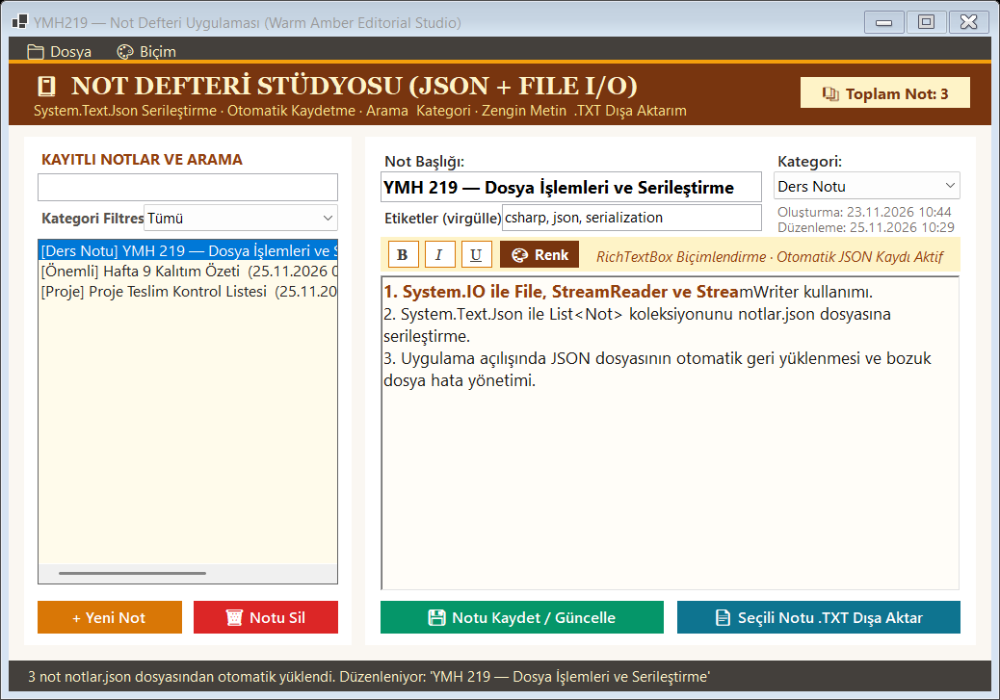
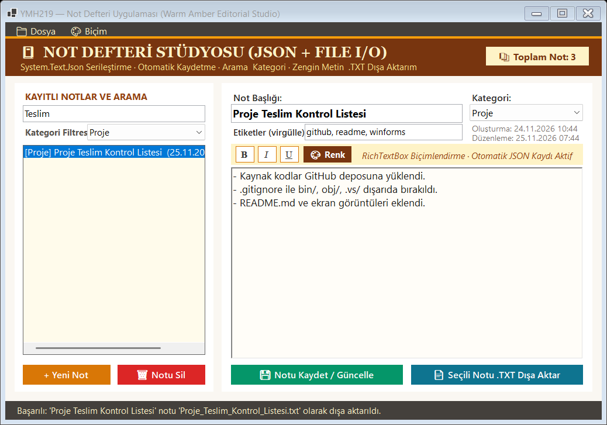

# 📓 YMH219 — Not Defteri Uygulaması (Dosya İşlemleri + Serileştirme)

> **Nesne Tabanlı Programlama (YMH 219)** dersi kapsamında C#, Windows Forms, `System.IO` ve `System.Text.Json` kullanılarak geliştirilmiş, **Warm Amber Editorial Studio** arayüz tasarımına sahip kalıcı not defteri uygulaması.

---

## 📌 Proje Adı ve Kısa Açıklama

**YMH219-NotepadApp**, kullanıcıların başlık, içerik, kategori ve etiketlerden oluşan notlarını ekleyebildiği, listeleyebildiği, düzenleyebildiği, silebildiği ve `.txt` olarak dışa aktarabildiği nesne tabanlı bir masaüstü not defteri uygulamasıdır.

Not koleksiyonu (`List<Not>`) **`System.Text.Json`** ile `notlar.json` dosyasına serileştirilerek kalıcı hâle getirilir; uygulama kapatılıp tekrar açıldığında kayıtlı tüm notlar oluşturma ve düzenleme tarihleriyle birlikte otomatik olarak geri yüklenir.

---

## 🛠️ Kullanılan Teknoloji / NuGet Paketleri

| Bileşen | Detay |
| :--- | :--- |
| **Programlama Dili** | C# 12 |
| **Çatkı (Framework)** | .NET (`net10.0-windows` / Windows Forms) |
| **Dosya İşlemleri** | `System.IO` (`File`, `StreamReader`, `StreamWriter`) |
| **Serileştirme** | `System.Text.Json` (`JsonSerializer`) |
| **Harici NuGet Paketi** | Harici paket gerektirmez (Standart .NET Windows Desktop SDK ile çalışır) |

---

## 🚀 Kurulum ve Çalıştırma Adımları

1. **Depoyu klonlayın:**
   ```bash
   git clone https://github.com/fatmaturkmen244/YMH219-NotepadApp.git
   cd YMH219-NotepadApp
   ```
2. **Visual Studio ile çalıştırma:**
   - `YMH219-NotepadApp.sln` çözüm dosyasını **Visual Studio 2022** (veya üzeri) ile açın ve `F5` ile çalıştırın.
3. **Komut satırı (.NET CLI) ile çalıştırma:**
   ```bash
   dotnet run --project NotepadApp/NotepadApp.csproj
   ```

---

## ✨ Uygulamanın Temel Özellikleri

- **Tam CRUD İşlemleri ve Nesne Tabanlı Yapı (`Not` & `List<Not>`):**
  - Başlık, içerik, kategori, etiketler, `OlusturmaTarihi` ve `DuzenlemeTarihi` alanlarını tutan `Not` sınıfı.
  - Not ekleme, listeden seçip düzenleme, silme ve yeni not hazırlama işlevleri.
- **JSON Serileştirme ve Otomatik Kaydetme / Yükleme (`NotDeposuService`):**
  - Uygulama açılışında `notlar.json` dosyasını otomatik yükler; her ekleme, güncelleme ve silme işleminden sonra otomatik olarak diske yazar.
  - Dosya bulunamadığında veya JSON bozuk olduğunda uygulama çökmez; bozuk dosyayı `.bozuk_<tarih>` olarak yedekleyip kullanıcıya uyarı verir.
- **Düz Metin (`.txt`) Dışa Aktarım (`TxtAktarimService`):**
  - Seçili notu `SaveFileDialog` ve `StreamWriter` kullanarak meta verileriyle birlikte `.txt` dosyasına aktarır.
- **İsteğe Bağlı Geliştirmeler:**
  - Başlık, içerik ve etiketlere göre anlık **arama** ve **kategori filtresi**.
  - **Zengin Metin (`RichTextBox`)** biçimlendirme araçları (Kalın, İtalik, Altı Çizili, Yazı Rengi).

---

## 📸 Ekran Görüntüleri

### 1. Ana Ekran — Not Listesi, Zengin Metin Düzenleyici ve JSON Otomatik Kayıt


### 2. Arama / Kategori Filtreleme ve .TXT Dışa Aktarım Görünümü


---

## ⚠️ Bilinen Sınırlamalar / Geliştirme Notları

- Veriler varsayılan olarak uygulamanın çalıştığı dizindeki `notlar.json` dosyasında saklanır (`bin/` içindeki yerel çalışma verileri `.gitignore` ile repo dışında tutulmuştur).
- Zengin metin biçimlendirmeleri hem düz metin (`Icerik`) hem de RTF (`RtfIcerik`) olarak saklanır; `.txt` dışa aktarımında düz metin kullanılır.

---

## 👤 Öğrencinin Adı-Soyadı ve Öğrenci Numarası

- **Adı Soyadı:** Fatma Türkmen
- **Öğrenci Numarası:** `250541063`
- **Ders:** YMH 219 — Nesne Tabanlı Programlama
